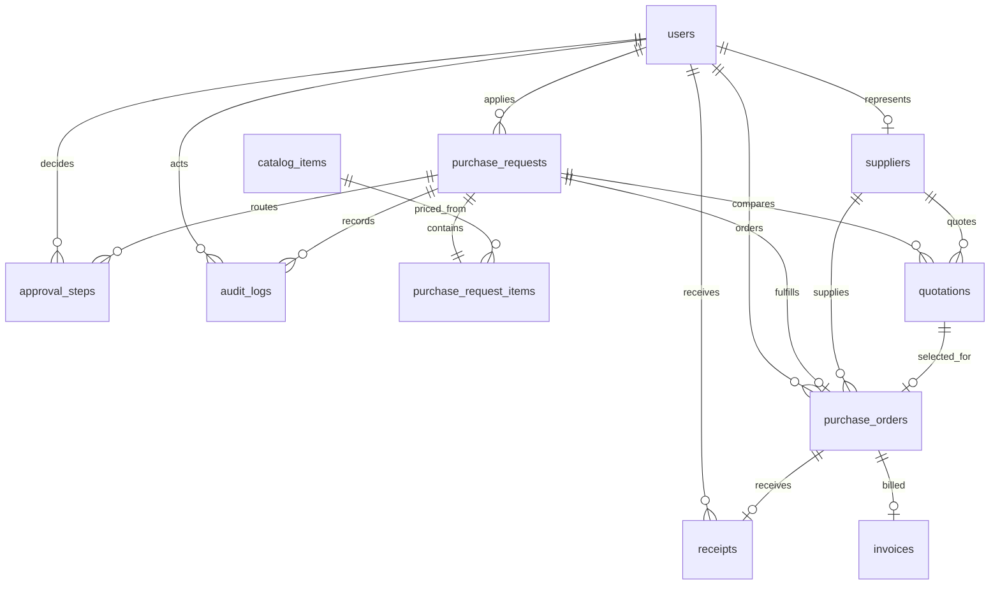

# ProcureFlow 構成・DB設計

Reactの日本語UIから、Next.js App Routerの `/api/workflow` へアクセスする。Vercel Functions上のRoute HandlerがNode.js用 `pg` ドライバーを使ってNeon PostgreSQLへ接続する。通常処理にはNeonのプール接続URLを使用できる。SQLの入力値はプレースホルダーで渡し、接続情報と更新PINはサーバー環境変数で管理する。

## ER図



| テーブル | 主キー | 外部キー・用途 |
| --- | --- | --- |
| users | id | 役割と部門 |
| suppliers | id | user_id → users。担当サプライヤー |
| catalog_items | id | 現行単価・有効状態 |
| purchase_requests | id | buyer_id → users。申請、金額、承認回、状態 |
| purchase_request_items | request_id | request_id → purchase_requests、item_id → catalog_items。数量・申請単価 |
| approval_steps | request_id、round、step | request_id → purchase_requests、actor_id → users。承認経路と結果 |
| quotations | id | request_id → purchase_requests、supplier_id → suppliers。見積額と採否 |
| purchase_orders | id | request_id → purchase_requests、buyer_id → users、supplier_id → suppliers。複合外部キーで同じ申請・仕入先の見積に限定 |
| receipts | id | order_id → purchase_orders、actor_id → users。数量と検収結果 |
| invoices | id | order_id → purchase_orders。請求額、請求日、支払状態 |
| audit_logs | id | request_id → purchase_requests、actor_id → users。操作・時刻 |
| schema_migrations | version | 適用済みSQLを記録 |

申請単価は明細に保存し、整数円で合計を計算する。申請行を `FOR UPDATE` でロックした上で業務条件を再検証し、更新と監査記録を同一トランザクションに格納する。発注と検収と請求は親IDを一意にする。承認回を増やした場合も旧ラウンドの結果を保持する。

## 申請から支払の追跡

```sql
SELECT t.id, t.item, t.status, t.order_id, t.order_amount,
       t.received_quantity, t.invoice_amount, t.payment_status
FROM transactions t
WHERE t.id = $1 OR t.order_id = $2;

SELECT round, step, role, decision, comment, acted_at
FROM approval_steps WHERE request_id = $1 ORDER BY round, step;
```

ビューのJOIN定義は `sql/001_schema.sql`、初期データは `sql/seed.sql` にある。